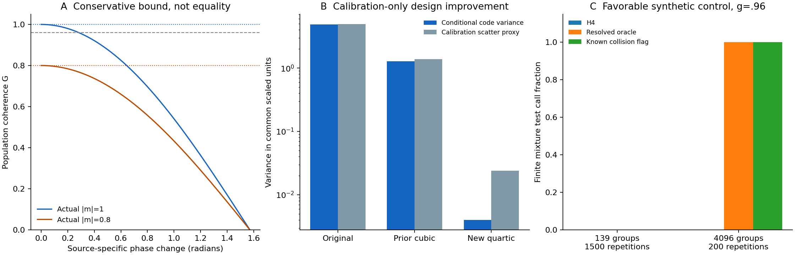

# Result: a conditional robustness extension, not physical closure

The four-panel construction removes a specific algebraic obstacle: arbitrary
source-specific **between-window** kernel changes no longer require pretending
that one optical ratio point-identifies physical motion. With the assumptions
below, it gives a conservative lower bound on displacement coherence, and thus
an upper variance budget when the stipulated Gaussian transform applies.

The original physical equivalence experiment still fails. Its entire primary
difference interval [-.0363158,.0103241] does not fit [-.02,.02]; all 256 original
useful nontrivial-motion calls failed. This new target does not change that
criterion or supply the missing independent common-bias bound. No scored
validation arrays, reserved acquisitions or new physical outcomes were opened.

[Figure details and limits](FIGURE_CAPTION.md).

## What was established

With four disjoint panels and identical source weights
w=n_a*n_b*n_c*n_d in every moment, the source-isolated complex cross moment C
and within-window references RA,RB satisfy

    G=|C|/sqrt(RA*RB)=|m| rho <= |m|,  0<=rho<=1.

Here m is the common displacement characteristic conditional on the complete
source kernel/count profile. rho measures kernel-vector coherence. The bound
is sharp: low G can arise from kernel changes even without motion. A high G
can constrain motion only under the conditional independence/common-law model.
The [derivation](THEORY.md) and exact enumeration independently check the
complex contraction and its full four-component coding covariance.

The required within-window kernel stability, exogenous codes, panel
factorization, count/selection transport and independent sampling units are
physical assumptions, not conclusions of a successful statistic. Correlated
imaging error can exactly cancel motion. Within-window changes can produce
G=1 when actual |m|=.64, despite reference products .25. Mean displacement,
acquisition-wide common random motion and heterogeneous source laws also
require separate treatment. Four-panel count weights are not the old cubic
weights when source dynamics differ. These counterexamples are retained as
tests, not removed as inconvenient cases.

There is also an observation-level limit. Replacing physical positions X by
X+U and imaging bias B by B-U leaves **all** recorded positions, codes and
calibration reads unchanged, while changing physical motion. We implement this
as an exact counterexample. No better software can distinguish those two models
from these observations alone. A matched bias constraint or a justified model
exclusion is additional information, not an inference optimization.

## A real design improvement, limited to exposed calibration

All 279 calibration sources and all 139 groups remain. The same total four-count
mass (233.749654720226 in one common numerical scale) is retained; no source,
weak-count case or unfavorable code assignment was dropped. The source
diagonal calibration coherence is .99548584 for every grouping. The phase and
scale of the witness were fitted on these calibration reads and are explicitly
training quantities.

| Grouping | Exact conditional coding variance of the witness | Calibration scatter proxy including between-group variation |
|---|---:|---:|
| Original groups | 4.8927300 | 4.9624838 |
| Prior cubic-optimized groups | 1.2747860 | 1.3898319 |
| New quartic-optimized groups | .00399954 | .0238982 |

The reduction in conditional code variance is about **1,223-fold** relative to
the original grouping and **319-fold** relative to the prior grouping. The
larger scatter proxy improves by about 208-fold and 58-fold, respectively.
Literal enumeration of every code assignment within each retained group
independently verifies the conditional coding variances. The optimization
minimizes the newly derived quartic witness covariance plus calibration group
scatter while freezing the existing triple. It does not choose random seeds.

These are calibration-design calculations. They do not measure a held-out
precision gain, physical sampling coverage or clinical/biological usefulness.
In particular, the scatter proxy is not a verified physical uncertainty budget.
The new groups are saved for reproducibility, not silently installed in the
historical estimator or substituted for the failed experiment.

Strong alternatives are retained. On these calibration observations, an exact
current count-mass control can reduce coding variance further, to .00000727,
but requires independently known current source-count mass. A source-resolved
oracle has zero coding variance, requiring identities on scored reads. A
collision-aware estimator is unbiased when its collision flag is known from
the source-code design; it is worse than the new grouping here (.154771 coding
variance). Inferring its flag from detected occupancy is biased when sources
can disappear. These information requirements preclude a universal-win claim.

## Honest finite-sample usefulness check

The [fixed simulation plan](SIMULATION_PLAN.md) was tested with seed 20261029:
12,400 synthetic repetitions across ten controls, including valid nulls,
positive controls and excluded assumption violations. All are simulations;
none adds independent acquisitions to this project.

At **139 synthetic independent groups**, the finite fixed-mixture threshold
test and the simultaneous bounded-moment rectangle make **zero g=.96 calls**
in every scenario (1500 repetitions each). That includes ideal stable kernels
with actual attenuation one. The absence of calls is a power limitation of
these conservative constructions, not evidence that the physical model holds
or a proof that every possible test must fail.

At 4096 synthetic groups (200 repetitions each), the source-resolved and
design-flagged alternatives pass the finite mixture test in all stable and
common-complex-change repetitions. Ordinary H4 passes none. We therefore
cannot describe the source-blind coded workflow as a useful 4% finite-sample
certificate at the available scale. Enlarging a simulated population does not
repair the real group's independence or reference gap.

The approximate t diagnostic is powerful in the stable 139-group control
(1500/1500), and is near its nominal boundary-null rate (82/1500 ordinary H4).
However, it also calls 1500/1500 under excluded motion/error compensation and
156/1500 under excluded within-window changes. Its fixed zero-phase direction
misses the common complex change. Those failures rule out upgrading it to a
physical certificate or selecting a favorable direction on scored reads.
Exact binomial Monte Carlo intervals and all comparator results are in
[simulation-results.json](simulation-results.json).

## Consequence for the paper

This adds an implementable partial-identification result and a covariance-based
design calculation. It addresses source-specific changing kernels under stated
assumptions. It does **not** empirically close labeling/selection effects,
shared source errors, common imaging bias or limited independent preparations.
Normalized coherence and its geometry are established prior work, so their
generic mathematics cannot carry a large novelty claim; see [the comparison](PRIOR_WORK.md).

The defensible manuscript remains a focused measurement-and-reconciliation
paper. Keep this extension as research evidence unless a separately qualified
future study establishes its practical utility. No manuscript claim or shipped
estimator has been upgraded. Randomized molecular MERFISH remains simulation
only. The archive metadata inspection proceeds separately without an outcome
study; access recovery alone will not validate this model.
